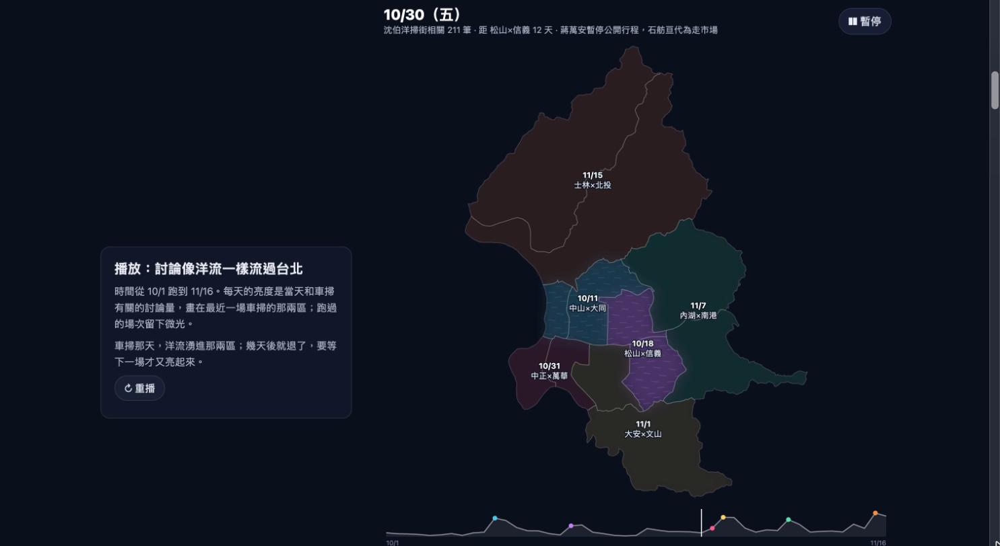
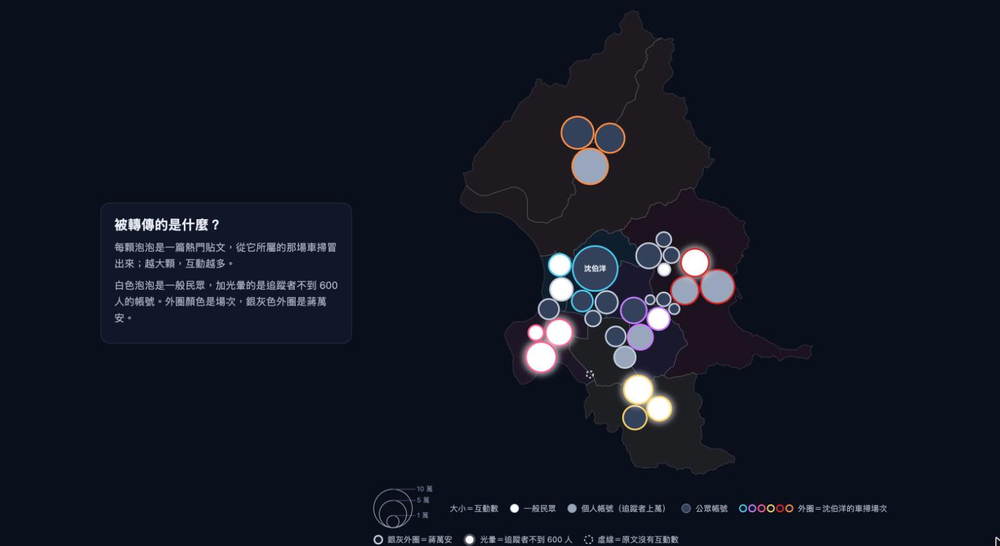
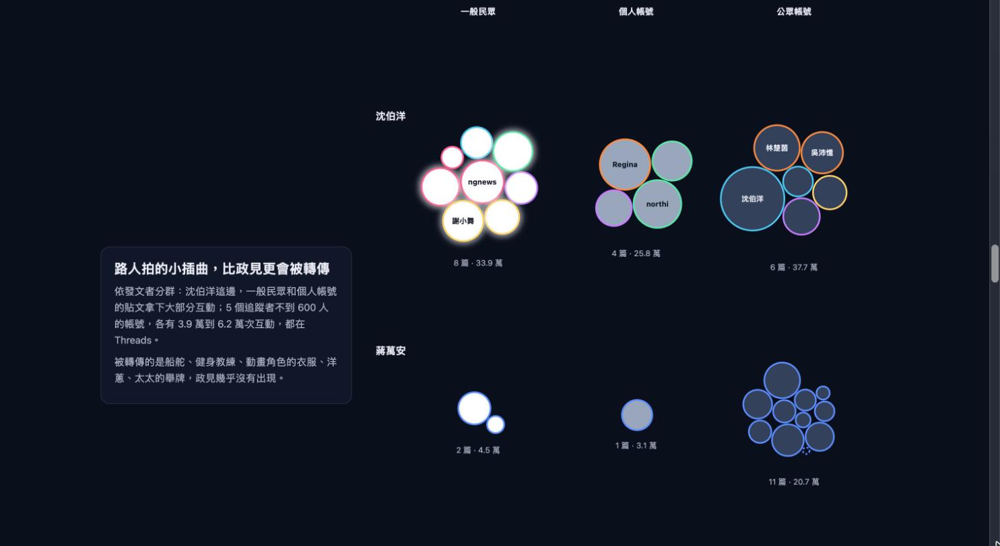
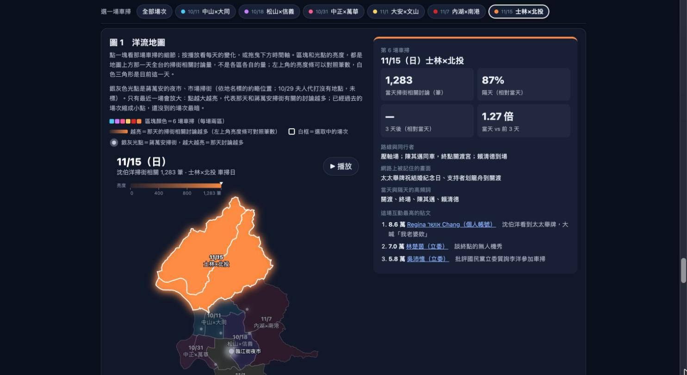

# 台北大洋流：車掃熱度只延續兩三天，被轉傳的多是路人拍的小插曲

輔仁大學「資料分析與視覺化應用」HW3 · News visualization。找一篇有資料視覺化的文章，指出原圖的缺點，再用 D3.js 改良重做。

- **組員**：415085047 嚴庭亞、410262690 陳予璇
- **原文**：QSearch〈[街頭陸戰遇上網路空戰：沈伯洋車掃、蔣萬安走夜市，社群在聊什麼？](https://www.qsearch.cc/blog/2026/11/2026-taipei-mayoral-street-campaign-social-volume/)〉（2026/11/17）
- **線上版**：<https://victorien1963.github.io/1151VIS-HW3-415085047-YEN-TING-YA-410262690-CHEN-YU-HSUAN/>
- **GitHub**：<https://github.com/victorien1963/1151VIS-HW3-415085047-YEN-TING-YA-410262690-CHEN-YU-HSUAN>
- **YouTube 互動影片**：（錄影後補上連結）

**怎麼看成品**　直接開上面的線上版。也可以從 GitHub 的 **Code → Download ZIP** 下載並解壓，用 Chrome、Safari 或 Edge 開啟 `index.html`；D3、地圖和資料都放在 repo 裡，不需要網路。

## 專案截圖

| 捲動敘事：洋流地圖播放 | 捲動敘事：貼文泡泡從各場車掃冒出來 |
|---|---|
|  |  |

| 捲動敘事：依發文者類型分群 | 自己探索：點地圖看 11/15 士林×北投的詳細資料 |
|---|---|
|  |  |

## 原圖的問題

原文有 4 張圖和 2 張貼文表格，結論是三件事：車掃當天聲量是前 3 天的幾倍、熱度延續幾天、被轉傳的貼文是誰發的。但原圖大多只畫原始筆數，這三件事都要讀者自己從內文找。

| 原圖 | 問題 |
|---|---|
| [圖二](https://storage.googleapis.com/best-life.appspot.com/1/2026/11/image-13.png)：前 3 天平均 vs 車掃當天的長條圖 | 重點是 1.03～1.27 倍，但長條從 0 畫起，差 3%～27% 看起來幾乎一樣高。整張圖最搶眼的是 1.80 倍那根，偏偏它是文章說「不列入比較」的場次。最重要的對照組（沒車掃的週末是 0.99 倍）沒有畫出來。 |
| [圖三](https://storage.googleapis.com/best-life.appspot.com/1/2026/11/image-9.png)：掃街討論每日折線 | 要講「熱度只延續兩三天」，讀者卻得自己數高峰後每天掉多少；7～10 成、2～3 成這些數字只寫在內文。這張圖和圖四的上半張是同一條線。 |
| [圖四](https://storage.googleapis.com/best-life.appspot.com/1/2026/11/image-10.png)：沈、蔣上下兩張折線 | 兩張刻度不同，場次標籤擠在一起。蔣萬安的重點是「有 2 場隔天反而變多」，圖上看不出來。 |
| 兩張熱門貼文表 | 結論是「沈伯洋這邊多是一般民眾、蔣萬安這邊多是政治人物與媒體」，但 32 列文字要讀者自己數。 |

## 改版做法

頁面分成兩部分：上半是**捲動敘事**，照文章的結論一段一段講；下半是**自己探索**，所有圖雙向連動。

### 捲動敘事（參考課程 Week 1 範例：Uber、關鍵評論網的捲動敘事）

畫面右邊（手機是上方）固定一個舞台，左邊文字捲到哪一段，舞台就換成那一段的圖：

1. **6 場車掃走遍台北 12 區**：台北市地圖依 6 場車掃分成 6 塊，每場一種顏色。
2. **洋流地圖播放**（參考 Facebook Friendship 發光地圖）：時間從 10/1 跑到 11/16，每天的掃街討論量決定亮度，畫在最近一場車掃的那兩區，區內有流動的波紋；車掃那天亮起來，幾天後退掉。下方的走勢線可以拖曳。
3. **熱度只延續兩三天**：6 場對齊到「當天＝100%」，線條依序畫出，標出文章說的「隔天 7～10 成」「3 天後 2～3 成」。
4. **車掃當天比前 3 天多了多少**（取代原圖二）：點從「前 3 天平均」滑到「車掃當天」，受辯論影響的兩場是灰色。
5. **被轉傳的是什麼**（參考 g0v 政治獻金泡泡圖）：每篇熱門貼文一顆泡泡，從所屬的車掃區（或蔣萬安的夜市）冒出來。
6. **路人拍的小插曲比政見更會被轉傳**：泡泡用物理模擬飛到「候選人 × 發文者類型」的群組，算出沈伯洋的熱門貼文有 61% 的互動來自一般民眾和個人帳號，蔣萬安只有 27%。
7. **蔣萬安走夜市**：地圖淡出沈伯洋的場次，亮起蔣萬安的夜市光點。
8. **聲量不等於選票**：資料限制。

### 自己探索

在上方場次按鈕、地圖區塊、泡泡、總覽圓點、對齊圖的線、點圖的列，任何一處點一場沈伯洋車掃，全部的圖都會固定標出這一場；只是滑過去，其他圖會暫時預覽那一場。

- **洋流地圖＋詳細資料卡**：點一塊，旁邊的卡片顯示這一場的路線、同行者、被記住的畫面、高頻詞、當天筆數、隔天與 3 天後剩幾成、當天 vs 前 3 天的倍數，以及互動最高的 3 篇貼文。地圖可以播放或拖曳時間。
- **熱門貼文泡泡圖**：可切換「依發文者類型」「依場次」「依地點」分群。泡泡大小是互動數，填色是發文者類型（白＝一般民眾、灰＝個人帳號、深＝公眾帳號），外圈是場次顏色，光暈是追蹤者不到 600 人。點沈伯洋的貼文會切到那一場。
- **每天的掃街討論**（總覽）、**對齊掃街當天**（取代原圖三、四，沈、蔣用同一個百分比刻度）、**當天 vs 前 3 天**（取代原圖二）。

**操作方式**：滑鼠滑過看數字並預覽場次；點來選場次，點「全部場次」取消；鍵盤可用 Tab 移到各個按鈕、區塊、泡泡，按 Enter 或空白鍵選取；在對齊小圖上按左右鍵切換場次。最下方的「看資料表」列出所有數字。

**設計上的選擇**

- 地圖要發光，整頁用深色。6 場車掃各一種顏色，地圖、總覽、對齊圖、倍數圖、泡泡外圈都用同一套，讀者靠顏色就能跨圖找到同一場。
- 泡泡的填色改用明暗（白、灰、深）表示發文者類型，不和場次顏色衝突；「一般民眾」最亮，呼應「素人也能衝出數萬互動」。
- 兩位候選人的查詢會重疊（一篇同時提到兩人，兩邊都算），所以不把兩人的筆數畫在同一個刻度上比高低，只比各自的起伏。
- 系統設定「減少動態效果」時，波紋與動畫會停用。

## 製作流程

1. **讀文章、找缺點**：對照內文與 4 張圖，整理每張圖想傳達的結論和沒做到的地方（上表）。
2. **取得資料**（`tools/`、`data/`）
   - 兩張貼文表、場次路線、同行者、高頻詞：直接從文章轉錄，附原貼文連結。
   - 每日掃街相關筆數：原文只有圖片，用 `tools/digitize_line_chart.js` 在瀏覽器讀出折線每一天的像素位置，換算成數字。和文中寫明的 9 個數字比對，誤差在 ±3 筆內；寫明的數字直接用原值（CSV 的 `is_exact` 欄）。
   - 前 3 天平均與當天筆數：從圖二長條的高度換算，誤差約 ±30 筆；倍數用原圖標示的值。
   - 提到候選人的每日總聲量：原文的「台北市長選戰總複習」網站把資料寫在頁面裡，可取得精確值（`data/candidate_mentions_daily.csv`）。這份只有 Threads、Facebook、新聞三平台，沒有 YouTube，目前頁面沒有用到，保留給之後延伸。
   - `tools/extract_from_article.py` 把以上整理成 `data/` 的 CSV 與 `data/data.json`。
3. **地圖資料**：台北市 12 區界線取自內政部「鄉鎮市區界線」開放資料，經 [taiwan-atlas](https://github.com/dkaoster/taiwan-atlas)（MIT）簡化成 TopoJSON，再用 `tools/topo_to_taipei.py` 轉成 `taipei-geo.js`。蔣萬安的夜市位置是我們依地名標的約略座標（寫在 `js/common.js`）。
4. **轉成網頁資料**：`python3 build_data.py` 把 `data/` 的 CSV 轉成 `chart-data.js`（網頁直接載入，不需要伺服器）。
5. **用 D3.js v7 繪圖**（`js/`）
   - 地圖：`d3.geoMercator` 投影；發光用 SVG 高斯模糊濾鏡；波紋是裁切在行政區內的波浪線，用 CSS 動畫讓虛線流動；時間播放用 `d3.interval`。
   - 泡泡：`d3.forceSimulation`（`forceX`、`forceY`、`forceCollide`），切換分群時更新目標位置讓泡泡飛過去。
   - 捲動敘事：`IntersectionObserver` 偵測文字段落進到畫面中線（手機是畫面下段），切換舞台上的圖層。
   - 連動：場次狀態分成 `session`（點選固定）和 `hover`（滑過預覽，優先）。點選會重畫全部圖；滑過只更新「其他」圖，觸發的那張不重畫，避免游標下的元素被換掉。蔣萬安的掃街日期和沈伯洋的車掃對不上，所以他的對齊小圖獨立選取，不參與連動。

## 檔案

| 檔案 | 內容 |
|---|---|
| `index.html`、`styles.css` | 頁面與樣式 |
| `js/common.js` | 共用：資料整理、場次顏色、夜市座標、提示框、連動狀態 |
| `js/map.js` | 洋流發光地圖 |
| `js/bubbles.js` | 熱門貼文泡泡圖 |
| `js/story.js` | 捲動敘事 |
| `js/explore.js` | 自己探索區（地圖＋資料卡、泡泡、總覽、對齊圖、倍數圖、資料表） |
| `chart-data.js` | 由 `build_data.py` 產生，不要手改 |
| `taipei-geo.js` | 台北市 12 區界線，由 `tools/topo_to_taipei.py` 產生 |
| `data/*.csv`、`data/data.json` | 整理後的資料，欄位說明在 `data/data.json` 的 `meta` |
| `tools/` | 取得資料用的腳本與專題網站的原始資料 |
| `vendor/d3.v7.9.0.min.js` | D3.js（ISC 授權，見 `vendor/d3-LICENSE.txt`） |
| `archive/tpoc-yangliu/` | 第一版題目（TPOC「洋流」動員公文前後的聲量比較），已改題目，保留備查 |

## 資料限制

- 每日筆數除了文中寫明的值，都是從圖片讀出的估計值。
- 地圖的亮度是「每天全台」和車掃有關的討論，畫在最近一場車掃的那兩區，不是各區各自的討論量。
- 互動數是原文作者 11/17 查看時的數字，「萬」為四捨五入後的值。
- 聲量只代表被討論的多寡，不分支持或批評，也不能證明是掃街帶動的。
